<div align="center">

# AyushCare

**Patient to Care. Without Delay.**

AI-assisted multilingual patient intake, emergency management, and clinical handoff.<br>
*From registration and triage to emergency response, documents, vitals, queueing, and physician review.*

<br>

[](AyushCareKiosk/)
[](AyushCareAI/)
[](AyushCareBackend/)
[](AyushCareMobile/)
[](HNDPANEL/)

</div>

<br>

> **Patient to Care. Without Delay.** P2Care turns a patient's arrival — routine or emergency — into a structured,
> multilingual clinical intake that can be reviewed by the right doctor with less repetition and
> less paperwork.

P2Care is a connected healthcare platform for hospitals and clinics. A patient can begin at a
physical kiosk, continue on a phone through a QR handoff, and arrive in a doctor workspace with
structured history, vitals, documents, consent, risk signals, and queue context. In emergencies,
P2Care supports unidentified patient intake, SOS management, and time-limited access authorization.

## At a glance

| Patient experience | Clinical intelligence | Hospital operations | Emergency response |
| --- | --- | --- | --- |
| Multilingual kiosk intake, voice and touch interaction, mobile continuity, and patient-controlled privacy | Adaptive interview, document extraction, red-flag detection, vitals, and clinician-reviewed summaries | Department routing, doctor assignment, OPD tokens, queue visibility, rosters, rooms, and consultation sign-off | Emergency/SOS intake, unidentified patient workflow, 36-hour access grants, case management, and audit trail |

AyushCare is built around one connected handoff: **the patient tells their story once, the system
organizes it responsibly, and the care team starts with context.**

## Contents

- [Why it matters](#why-it-matters)
- [What it does](#what-it-does)
- [Emergency features](#emergency-features)
- [Patient journey](#patient-journey)
- [System architecture](#system-architecture)
- [AI and clinical safety](#ai-and-clinical-safety)
- [Product surfaces](#product-surfaces)
- [Demonstration flow](#demonstration-flow)
- [Repository structure](#repository-structure)
- [Technology stack](#technology-stack)
- [Run locally](#run-locally)
- [Demo credentials](#demo-credentials)
- [Documentation](#documentation)

<br>

## Why it matters

The front desk is often where clinical information gets fragmented. Patients repeat the same story,
reports stay in paper folders, and doctors spend valuable consultation time reconstructing context.
In emergencies, unidentified patients arrive without records, and staff need structured workflows
to provide care without delay. P2Care addresses both routine and emergency scenarios.

| Before the consultation | P2Care workflow |
| --- | --- |
| Repeated registration questions | Guided, stateful patient intake |
| Paper prescriptions and reports | QR-assisted phone upload and document processing |
| Unstructured patient history | AI-assisted clinical summary with source context |
| Unclear department routing | Department, pathway, doctor, and token flow |
| Language and accessibility barriers | Multilingual UI plus voice input and narration |
| Uncontrolled record sharing | Granular consent, patient privacy controls, and scoped access grants |
| No emergency workflow | SOS/emergency intake, unidentified patient management, time-limited access |

## What it does

- **Guided patient intake** — identity, consent, language, department, pathway, symptoms, and history.
- **AI clinical interview** — adaptive SOCRATES-style questioning with text and speech input.
- **Safety-first triage** — deterministic red-flag rules, compound pattern detection, and escalation signals.
- **Document intelligence** — upload prescriptions, laboratory reports, and medical documents for OCR and structured extraction.
- **Clinical summary generation** — physician-ready sections with patient-reported and document-derived context.
- **Vitals and queue management** — kiosk measurements, OPD tokens, consultation status, and doctor assignment.
- **QR continuity** — pair a kiosk session with a mobile portal so patients can upload documents from their own phone.
- **Privacy and consent** — DPDPA-oriented consent receipts, privacy settings, scoped sharing rules, and audit events.
- **Clinician workspace** — doctor queue, patient summary, reports, vitals, notes, and consultation sign-off.

## Emergency features

P2Care extends the core platform with emergency care capabilities:

- **Emergency intake** — structured emergency case creation from the kiosk or HNDPANEL, with category selection, presenting complaint, and triage urgency.
- **Unidentified patient workflow** — separate emergency case storage for patients who cannot be identified, with controlled identity linking when verification becomes possible.
- **SOS management** — persistent SOS incidents with acknowledge, assign, escalate, update, and resolve actions.
- **Time-limited access grants** — backend-enforced patient data access with a maximum 36-hour validity, scoped to specific data categories, with mandatory audit logging.
- **Emergency dashboard** — real-time case list in HNDPANEL with status badges, urgency indicators, staff assignment, and action timeline.
- **Audit trail** — append-only logging of all access grants, case actions, and data access attempts.

## Patient journey

```mermaid
flowchart LR
  A[Patient arrives] --> B[Choose language]
  B --> C[Identity and consent]
  C --> D[Department and doctor routing]
  D --> E[AI clinical interview]
  E --> F[Vitals and red-flag checks]
  F --> G[Upload documents by QR]
  G --> H[Generate clinical summary]
  H --> I[Token and queue]
  I --> J[Doctor review and sign-off]
```

### Emergency path

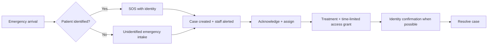

## System architecture

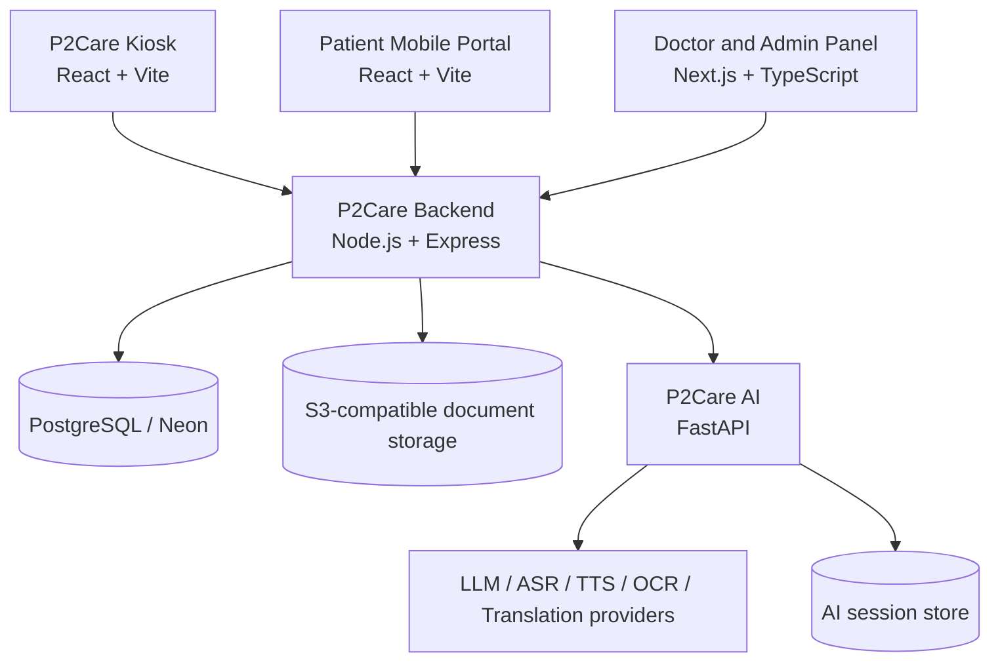

The core API owns identity, consultations, routing, queue state, document registration, consent,
privacy, emergency cases, access grants, and portal access. The Python service owns the clinical
conversation, document intelligence, summary generation, safety checks, and FHIR preview.
Frontends remain presentation and workflow clients.

## AI and clinical safety

The AI layer is assistive by design. It does **not** diagnose, prescribe, or replace clinical judgement.

| Capability | Implementation |
| --- | --- |
| Clinical interview | Adaptive history collection following SOCRATES-style questioning |
| Speech | Server-side ASR and TTS integration with multilingual support |
| Document processing | OCR, medical entity extraction, abnormal-value flagging, and image quality checks |
| Safety | Deterministic red-flag rules plus LLM-assisted compound pattern detection |
| Summary | Structured clinical summary with clinician accept, reject, and edit workflow |
| Interoperability | FHIR R4 bundle preview |
| Governance | Consent receipts, audit logging, privacy settings, and scoped access rules |

## Product surfaces

### 1. P2Care Kiosk

<table>
  <tr>
    <td align="center">
      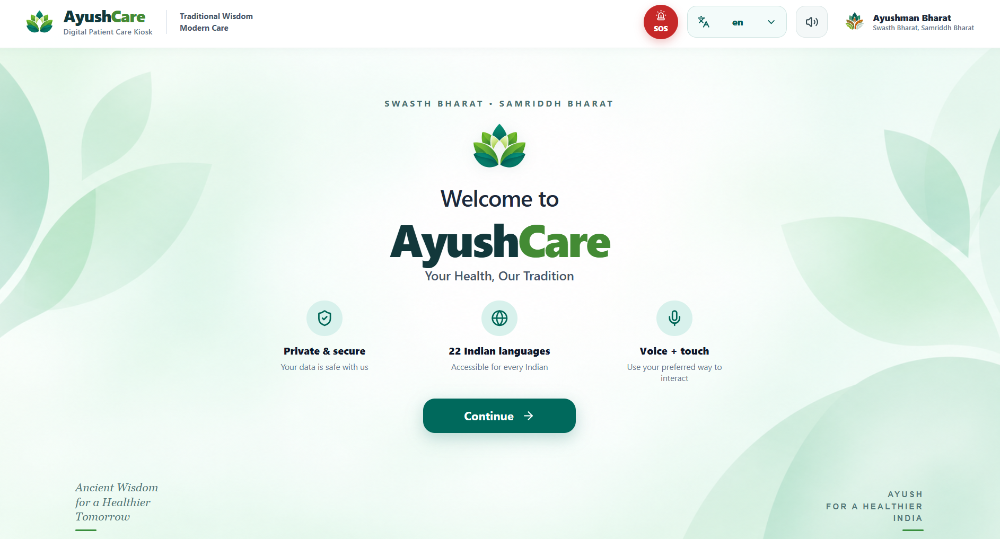
      <br><sub>Welcome, language, and accessible intake start</sub>
    </td>
    <td align="center">
      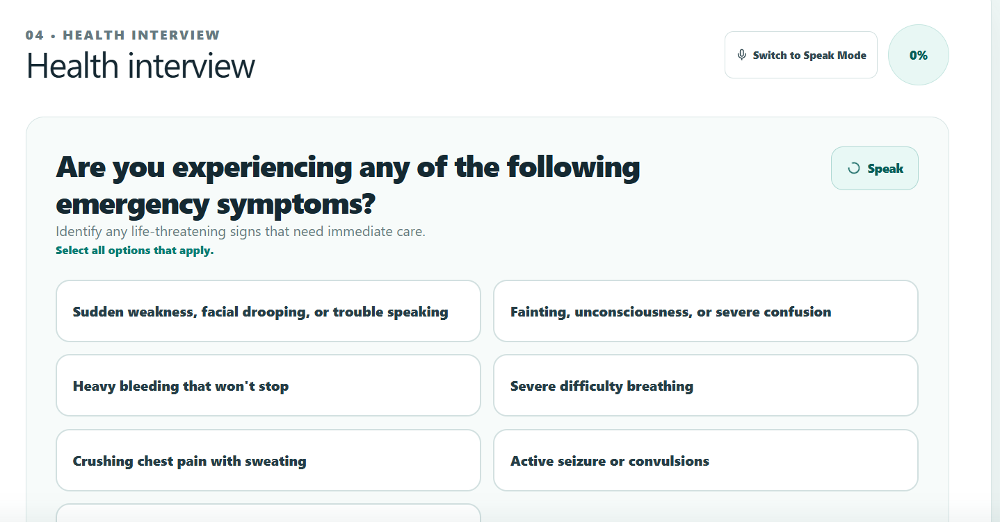
      <br><sub>Emergency symptom screening and guided interview</sub>
    </td>
    <td align="center">
      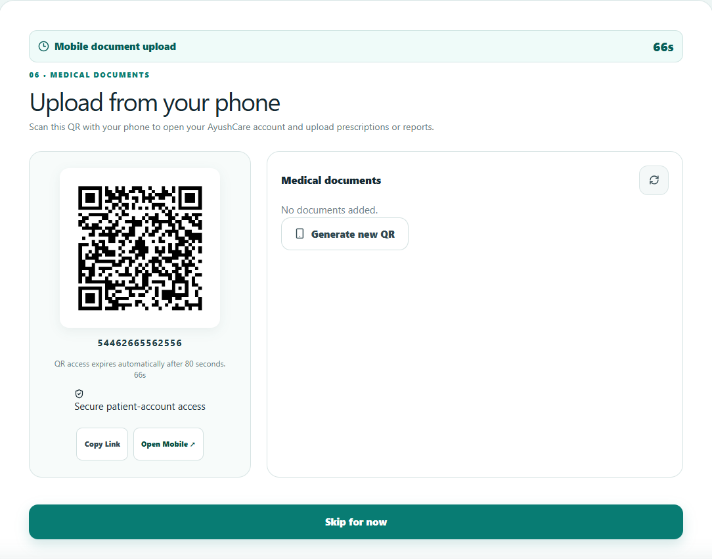
      <br><sub>QR handoff for mobile document upload</sub>
    </td>
  </tr>
</table>

The kiosk combines language selection, privacy messaging, voice and touch interaction, emergency
screening, guided responses, and a secure QR handoff for prescriptions and reports. In emergencies,
the kiosk supports unidentified patient intake with category selection and immediate staff alerting.

### 2. P2Care Mobile

<table>
  <tr>
    <td align="center">
      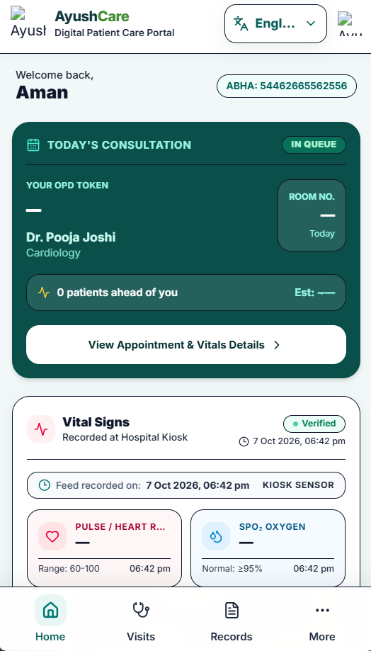
      <br><sub>Home and verified vitals</sub>
    </td>
    <td align="center">
      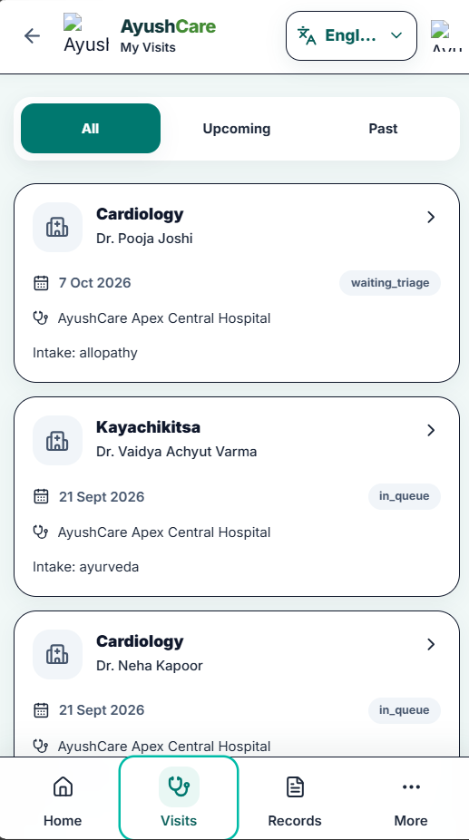
      <br><sub>Visits and appointments</sub>
    </td>
    <td align="center">
      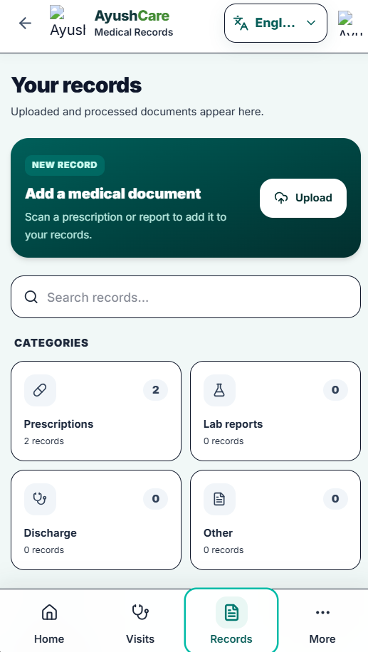
      <br><sub>Medical records</sub>
    </td>
    <td align="center">
      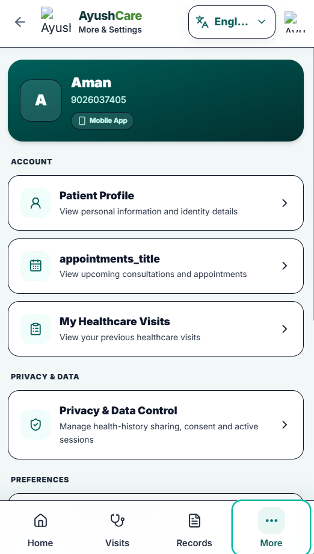
      <br><sub>Privacy and settings</sub>
    </td>
  </tr>
</table>

The mobile portal carries the patient beyond the kiosk: active consultation status, queue context,
visits, records, appointments, profile details, and privacy controls remain available from one place.

### 3. P2Care Doctor and Admin Panel

<table>
  <tr>
    <td align="center">
      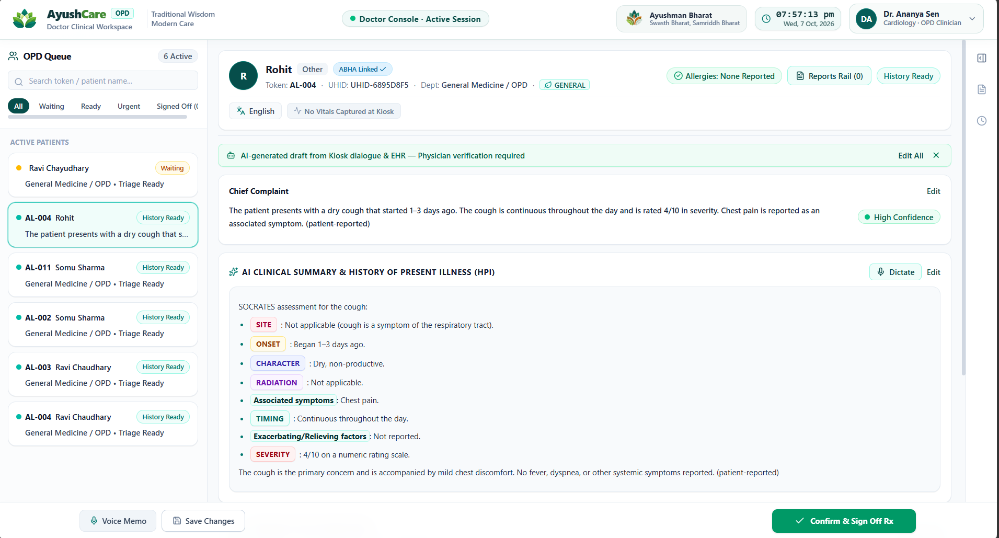
      <br><sub>Doctor clinical workspace: queue, AI summary, evidence, editing, and sign-off</sub>
    </td>
    <td align="center">
      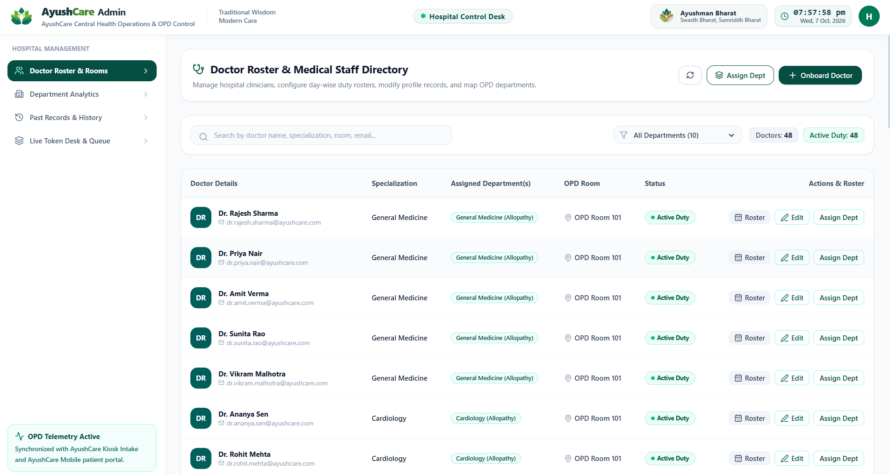
      <br><sub>Admin control desk: emergency dashboard, rosters, departments, rooms, and schedules</sub>
    </td>
  </tr>
</table>

The doctor and admin surfaces turn the intake record into coordinated action: clinicians verify the
AI-assisted history, while hospital teams manage emergency cases, departments, rooms, and queues.

## Repository structure

```text
P2Care/
├── AyushCareAI/              # FastAPI clinical AI service and tests
├── AyushCareBackend/         # Express API, PostgreSQL access, auth, emergency, queue, and storage
├── AyushCareKiosk/           # React/Vite patient kiosk experience
├── AyushCareMobile/          # React/Vite mobile portal and document flow
├── HNDPANEL/                 # Next.js doctor and hospital admin panel (with emergency dashboard)
├── docs/screenshots/         # Product walkthrough screenshots
└── requirements.md           # P2Care extension requirements specification
```

## Service map

| Service | Responsibility | Default port |
| --- | --- | ---: |
| `AyushCareKiosk` | Patient check-in, intake, consent, interview, vitals, SOS/emergency, QR handoff | `5173` |
| `AyushCareMobile` | Patient portal, documents, visits, records, and privacy | `5174` |
| `AyushCareBackend` | Auth, consultations, routing, queue, emergency cases, access grants, QR sessions, storage | `8001` |
| `AyushCareAI` | Conversation, speech, OCR, extraction, safety, summaries, and FHIR preview | `8000` |
| `HNDPANEL` | Doctor clinical workspace, emergency/SOS dashboard, and hospital administration | `3000` |

## Technology stack

| Layer | Technology |
| --- | --- |
| Patient kiosk | React, Vite, Zustand, Axios, Lucide |
| Mobile portal | React, Vite, React Router, React Hook Form, Zod, Zustand |
| Doctor/admin panel | Next.js App Router, React, TypeScript, Tailwind CSS |
| Core backend | Node.js, Express, PostgreSQL, JWT, AWS S3 SDK |
| AI service | Python, FastAPI, Pydantic, SQLAlchemy, Redis |
| AI integrations | Gemini, Groq, Bhashini, Azure Document Intelligence, Azure Language, Tesseract |

## Run locally

### Prerequisites

- Python 3.10+
- Node.js and npm
- PostgreSQL (Neon or local)
- Redis is recommended for the AI service
- Provider credentials configured in server-side `.env` files

### Start the AI service

```bash
cd AyushCareAI
python -m venv .venv
.venv\Scripts\activate        # Windows
pip install -r requirements.txt
uvicorn app.main:app --reload --port 8000
```

### Start the core backend

```bash
cd AyushCareBackend
npm install
npm run dev                    # port 8001
```

### Bootstrap the database (schema + demo data)

```bash
cd AyushCareBackend
node src/database/bootstrap.js
```

> **Warning:** Verify the `DATABASE_URL` in `.env` points to the correct P2Care database before running.

### Start the patient applications

```bash
cd AyushCareKiosk
npm install
npm run dev                    # Vite, normally port 5173
```

```bash
cd AyushCareMobile
npm install
npm run dev                    # Vite, normally port 5174
```

### Start the doctor/admin panel

```bash
cd HNDPANEL
npm install
npm run dev                    # Next.js, normally port 3000
```

## Demo credentials

After running the bootstrap script, the following test accounts are available:

| Role | Email | Password |
| --- | --- | --- |
| Hospital Admin | `admin@ayushcare.com` | `Admin@123` |
| Doctor (General Medicine) | `dr.rajesh.sharma@ayushcare.com` | `Doctor@123` |
| Doctor (Cardiology) | `dr.ananya.sen@ayushcare.com` | `Doctor@123` |

**Patient lookups (kiosk):**

| Name | ABHA Number | Mobile |
| --- | --- | --- |
| Ramesh Kumar | `14-1111-2222-3333` | `9876543210` |
| Sunita Devi | `14-2222-3333-4444` | `9876543211` |

The HNDPANEL login page includes one-click auto-fill buttons for all demo credentials.

## Documentation

- [P2Care Requirements](requirements.md) — emergency extension requirements specification.
- [AI service README](AyushCareAI/README.md) — AI endpoints, providers, safety modules, and test commands.
- [Backend README](AyushCareBackend/README.md) — core API setup and integration notes.
- [Kiosk README](AyushCareKiosk/README.md) — kiosk workflow and frontend setup.
- [Mobile README](AyushCareMobile/README.md) — patient portal and QR upload flow.
- [Doctor panel README](HNDPANEL/README.md) — clinician and admin application setup.

## Safety and privacy note

P2Care is a clinical intake, emergency management, and decision-support platform. AI output must be
reviewed by qualified clinical staff before it is used in care. Deployments must complete their own
security, privacy, clinical-safety, consent, and regulatory review before handling real patient data.

## Licence

See the package and project metadata in each module for the applicable licensing terms before public
deployment or distribution.
